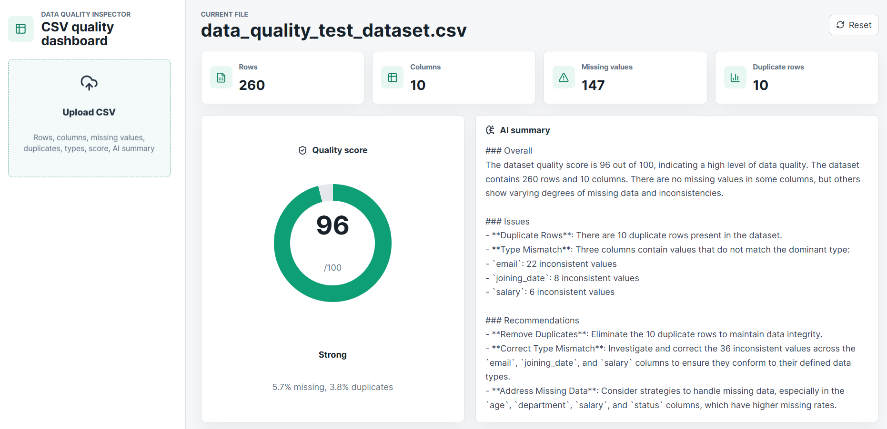
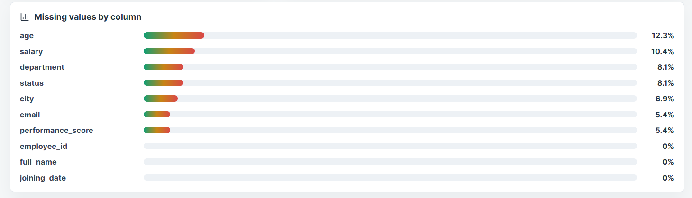
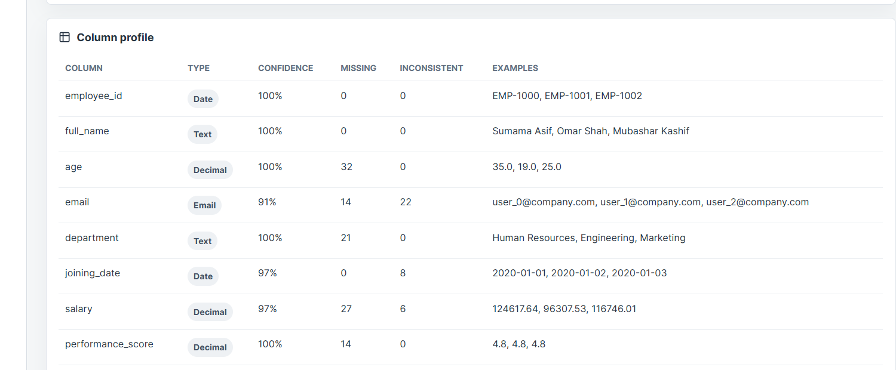
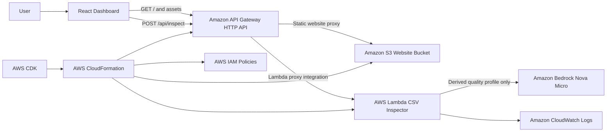

# Data Quality Inspector

A modern full-stack dashboard for inspecting CSV data quality. Users upload a CSV file and receive an instant profile of the dataset, including structural metrics, missing-value analysis, duplicate detection, inferred data types, a quality score, and an AI-generated summary with recommendations.

## Live Demo

Open the deployed application:

```text
https://u97j0opdi9.execute-api.us-east-2.amazonaws.com
```

## Screenshots



| Missing Values Analysis | Column Profile |
| --- | --- |
|  |  |

## Features

- CSV upload from the browser
- Row and column counts
- Missing values per column
- Duplicate row detection
- Data type detection for integers, decimals, dates, booleans, emails, URLs, text, and mixed values
- Data quality score from 0 to 100
- AI-generated data quality summary and recommendations
- Clean dashboard UI with metric cards, a score gauge, bar chart, and column profile table
- Serverless AWS deployment with infrastructure as code

## System Architecture



## Request Flow

1. The browser loads the React dashboard through Amazon API Gateway.
2. API Gateway proxies static frontend routes to the S3 website bucket.
3. The user uploads a CSV file in the browser.
4. The frontend sends the CSV text to `POST /api/inspect`.
5. API Gateway invokes the Lambda function.
6. Lambda parses the CSV, computes data quality metrics, and builds a compact quality profile.
7. Lambda sends only the derived profile to Amazon Bedrock for the AI summary.
8. The dashboard renders the metrics, charts, column table, quality score, and recommendations.

## AWS Services Used

| Service | Purpose |
| --- | --- |
| Amazon S3 | Stores and serves the built React frontend as static website files. |
| Amazon API Gateway HTTP API | Provides the public HTTPS application URL and routes frontend/API traffic. |
| AWS Lambda | Runs the CSV inspection backend without managing servers. |
| Amazon Bedrock | Generates the AI data quality summary and recommendations. |
| Amazon CloudWatch Logs | Captures Lambda logs for troubleshooting and operational visibility. |
| AWS IAM | Grants the Lambda function permission to invoke Bedrock. |
| AWS CloudFormation | Provisions and updates AWS resources. |
| AWS CDK | Defines the AWS infrastructure in TypeScript. |

CloudFront is the preferred CDN layer for a production frontend. This project uses API Gateway in front of S3 because the current AWS project rejected new CloudFront resources until project verification is completed.

## Tech Stack

- React
- TypeScript
- Vite
- AWS CDK
- AWS Lambda on Node.js
- Amazon Bedrock Runtime

## Local Development

Install dependencies:

```bash
npm install
```

Start the local frontend:

```bash
npm run dev
```

For local testing against a deployed API:

```powershell
$env:VITE_API_URL="https://YOUR_API_ID.execute-api.us-east-2.amazonaws.com"
npm run dev
```

## Deployment

The CDK stack targets `us-east-2` by default.

Bootstrap the target AWS project and Region:

```bash
npm install
npx cdk bootstrap aws://PROJECT_ID/us-east-2
```

Deploy:

```bash
npm run deploy
```

The deployed application URL is printed as the `ApplicationUrl` stack output.

## Configuration

Override the Bedrock model:

```bash
npm run deploy -- --context bedrockModelId=amazon.nova-micro-v1:0
```

Override the Bedrock runtime Region:

```bash
npm run deploy -- --context bedrockRegion=us-east-1
```

The deployed Lambda uses Bedrock Runtime in `us-east-1` by default because `us-east-2` returned `Operation not allowed` for runtime model invocation during testing, while `us-east-1` allowed Nova Micro on-demand invocation.

## Security And Privacy

- No AWS credentials or secrets are stored in the repository.
- Generated folders such as `node_modules`, `dist`, and `cdk.out` are ignored.
- Local logs and environment files are ignored.
- The Lambda sends a derived quality profile to Bedrock, not the full raw CSV.
- Uploaded CSV content is processed in memory by Lambda and is not persisted by this application.

## Sample Data

A small test file is included at:

```text
sample-data/customers.csv
```

Use it to verify the upload flow, missing-value chart, type detection, and AI summary.
